  <picture>
    <source media="(prefers-color-scheme: dark)" srcset="./assets/profile-dark.svg" />
    <source media="(prefers-color-scheme: light)" srcset="./assets/profile-light.svg" />
    
  </picture>

  <picture>
    <source media="(prefers-color-scheme: dark)" srcset="https://raw.githubusercontent.com/meenuraghuwanshi/meenuraghuwanshi/output/github-contribution-grid-snake-dark.svg" />
    <source media="(prefers-color-scheme: light)" srcset="https://raw.githubusercontent.com/meenuraghuwanshi/meenuraghuwanshi/output/github-contribution-grid-snake.svg" />
    
  </picture>

  <a href="https://github.com/meenuraghuwanshi">GitHub</a> ·
  <a href="https://github.com/meenuraghuwanshi">My GitHub</a>

---

### Before publishing

1. Create a **public** repository named exactly `meenuraghuwanshi`.
2. Add your LinkedIn and email links later if you want them displayed.
3. The profile generator is already set to Meenu Raghuwanshi; you can edit the tagline and about text in `scripts/generate_profile.py`.
4. Upload these files to the repository root, commit, and push to the `main` branch.
5. In the repository's **Actions** tab, run both workflows once. The dashboard refreshes daily and the snake workflow publishes its SVGs to the `output` branch.

### Theme

A purple-and-pink terminal aesthetic with a dark mode and a soft light mode. Project and technology details are loaded from your public GitHub repositories.
